<p align="center">
  
  
</p>

<p align="center">
  <strong>A fast, token-efficient coding agent. Built to compose.</strong>
</p>

<p align="center">
  <a href="https://radiantlabs.dev"></a>
  <a href="https://github.com/RadiantAILabs/polaris_code/tags"></a>
  <a href="https://crates.io/crates/polaris_code"></a>
  <a href="LICENSE"></a>
</p>

<p align="center">
  <a href="https://radiantlabs.dev"><strong>Website</strong></a> ·
  <a href="#get-started"><strong>Get started</strong></a> ·
  <a href="https://github.com/RadiantAILabs/polaris_code/releases"><strong>Releases</strong></a> ·
  <a href="#documentation"><strong>Documentation</strong></a> ·
  <a href="#benchmark"><strong>Benchmark</strong></a> ·
  <a href="https://github.com/RadiantAILabs/polaris"><strong>Polaris framework</strong></a>
</p>

<p align="center"></p>

<p align="center"><em>The whole graph is configurable: plugins add or replace steps, or you can edit the graph directly in Rust.</em></p>

Polaris Code is a terminal coding agent written in Rust, built on the
[Polaris](https://github.com/RadiantAILabs/polaris) agent framework. It reads your
project, edits code, and runs approved commands through Anthropic, OpenAI,
any OpenAI-compatible server, or AWS Bedrock. Model providers, tools, memory, and agent workflows compose as
plugins, and every decision and tool call is recorded in the session graph.

On all 500 SWE-bench Verified tasks, Polaris Code matched Claude Code's
solve rate with the same model, using **6.4x fewer tokens**, at **2.4x lower
cost**, and finishing tasks **2.4x faster**. See the
[benchmark and reproduction guide](#benchmark) for the measurements and scope.

## Why Polaris Code

- **Change the agent, not just its tools.** The agent loop is a graph; plugins
  add, replace, or rewire its steps.
- **A workflow for each task.** Coding tasks are matched to a catalog of task
  graphs, and the result records why one was chosen.
- **Fewer tokens.** Short planned steps with their own limits, ranged reads
  instead of whole files, and cached prompts.
- **See the agent run.** The Graph tab shows the step running now, live.
- **One knowledge graph.** Code index, session history, and memories share one
  queryable store; a memory goes stale when its code changes.
- **Inspectable and safe.** Review and rewind changes; edits and commands ask
  first.
- **Your provider.** Anthropic, OpenAI, any OpenAI-compatible server, or AWS
  Bedrock, in one Rust executable with no telemetry.

## How it compares

| | Polaris Code | Claude Code | Codex CLI | OpenCode | goose |
| --- | --- | --- | --- | --- | --- |
| Source | Apache-2.0 | Closed | Apache-2.0 | MIT | Apache-2.0 |
| Written in | Rust | TypeScript | Rust | TypeScript | Rust |
| Plugins can replace steps of the agent loop | Yes | No | No | No | No |
| Picks a workflow for each task and records why | Yes | No | No | No | No |
| Live view of the running agent graph | Yes | No | No | No | No |
| Head-to-head SWE-bench Verified result in the repository | Yes, all 500 tasks | — | No | No | No |

Because the workflow is a graph you can extend, there is no fixed limit on
how far Polaris Code can improve: add a workflow graph for a domain, such as
data migrations, security fixes, or a framework your team uses, and it is
admitted, ranked, and chosen alongside the built-in ones.

The other columns describe each project's public documentation as of
November 2026. Corrections are welcome as issues.

## Benchmark

All 500 SWE-bench Verified tasks, Claude Opus 5.5 on AWS Bedrock, one run per
task for each agent:

| | Polaris Code | Claude Code | Comparison |
| --- | ---: | ---: | --- |
| Solved | 451 / 500 (90.2%) | 455 / 500 (91.0%) | Same within chance (p = 0.56) |
| Total tokens | 24,584,288 | 156,735,519 | **6.4x token savings** |
| Cost (USD, estimated) | 44.52 | 108.34 | **2.4x cheaper** |
| Median task time | 34 s | 82 s | **2.4x faster** |

```text
MEASURE           POLARIS CODE       CLAUDE CODE
tasks solved      █████████░ 90.2%   █████████░ 91.0%
total tokens      ██░░░░░░░░ 24.6M   ██████████ 156.7M
cost (estimated)  ████░░░░░░ $44.52  ██████████ $108.34
median task time  ████░░░░░░ 34 s    ██████████ 82 s
```

The full results are published separately.
This repository contains the code and pinned inputs to re-run the comparison:
see the [reproduction guide](evals/reproduce/swebench-opus/README.md).

By repository, Polaris Code used between 3% and 24% of Claude Code's tokens
(task counts in brackets):

```text
flask (1)          ▊░░░░░░░░░░░░░░░░░░░░░░░░░░░░░  3%
requests (8)       ███▌░░░░░░░░░░░░░░░░░░░░░░░░░░  12%
xarray (22)        ███▋░░░░░░░░░░░░░░░░░░░░░░░░░░  12%
django (231)       ████▏░░░░░░░░░░░░░░░░░░░░░░░░░  14%
scikit-learn (32)  ████▋░░░░░░░░░░░░░░░░░░░░░░░░░  16%
matplotlib (34)    ████▉░░░░░░░░░░░░░░░░░░░░░░░░░  16%
sympy (75)         ████▉░░░░░░░░░░░░░░░░░░░░░░░░░  16%
pylint (10)        █████░░░░░░░░░░░░░░░░░░░░░░░░░  17%
seaborn (2)        █████▌░░░░░░░░░░░░░░░░░░░░░░░░  18%
sphinx (44)        █████▋░░░░░░░░░░░░░░░░░░░░░░░░  19%
astropy (22)       ██████▌░░░░░░░░░░░░░░░░░░░░░░░  21%
pytest (19)        ███████▏░░░░░░░░░░░░░░░░░░░░░░  24%
```

The figures are drawn with [Glyph kit](https://github.com/alextraykov/glyph-kit)
from the specs in [`docs/figures/swebench-500/`](docs/figures/swebench-500/).

## Get started

### Install

```bash
brew install radiantailabs/tap/polaris-code
```

Homebrew installs a prebuilt binary for Apple Silicon on macOS Sequoia and
newer, and Linux x86-64. On other platforms, use Cargo.
The formula is named `polaris-code`; the installed command is `polaris`.

Or install with Cargo using Rust 1.97.0 or newer:

```bash
cargo install polaris_code --locked
```

### Start a session

Save a key once, then launch Polaris in your project. `polaris login` asks
which provider you use, reads its key with the input hidden, stores it where
only you can read it, and makes that provider your default:

```bash
polaris login            # Anthropic, OpenAI or AWS Bedrock
polaris login status     # which providers have credentials, and from where
cd your-project
polaris .
```

Or export a key instead. An environment variable, or a `.env` file in the
folder you launch from, wins over a saved key:

```bash
export ANTHROPIC_API_KEY="your-key"
polaris .
```

### Run a single task

Use `-p` / `--print` for one unattended turn:

```bash
polaris -p "Summarize this workspace" --output-format json
```

Interactive sessions ask before edits and commands. Unattended runs require
explicit per-run grants to write files or execute commands. See
[permission modes](docs/permission-modes.md) for the available settings.

### Choose a provider

Select a provider with `--provider anthropic|openai|bedrock` or the
`POLARIS_CODE_PROVIDER` environment variable. OpenAI uses `OPENAI_API_KEY`, and
`OPENAI_BASE_URL` points it at an OpenAI-compatible server (Ollama, LM Studio,
vLLM, a gateway). Bedrock uses the AWS SDK credential chain:

```bash
export AWS_REGION=us-east-1
polaris --provider bedrock .
```

The SDK also accepts `AWS_PROFILE` or
`AWS_ACCESS_KEY_ID`/`AWS_SECRET_ACCESS_KEY`. Before the terminal opens, Polaris
checks the provider's credentials and, if something is missing, says what to
do.

`polaris --list-models` shows the models each provider offers, their prices,
and whether the credentials are present; `--model sonnet` picks the newest
Sonnet. Run `polaris --help` for all command-line options, and see
[providers](docs/providers.md) for OpenAI-compatible servers, where credentials
are stored, and the startup check.

### Keep separate setups

Set `POLARIS_CONFIG_DIR` to keep independent user setups:

```bash
POLARIS_CONFIG_DIR=~/.polaris-work polaris
```

This directory holds `config.toml` and its profiles, `credentials.toml`,
`permissions.toml`, and `mcp.json`. When unset or empty, it falls back to
`$XDG_CONFIG_HOME/polaris`, then `~/.config/polaris`. Project configuration and
session state stay in the workspace. `/status` shows the resolved directory and
whether `POLARIS_CONFIG_DIR` selected it. See
[startup configuration](docs/configuration.md).

### Set defaults

Put defaults in `config.toml` (yours) or `polaris.toml` (the project's). The
accepted keys are `provider`, `model`, `models`, `region`, `permission_mode`
(`confirm`, `auto-edit`, `auto`, or `plan`), `permission_ceiling`,
`max_cost_usd`, `max_tokens`, `max_turns`, and `max_output_tokens`. Flags and
environment variables win over both files.

Two options are flags or environment variables only: `--notify` /
`POLARIS_CODE_NOTIFY` (`off`, `approval`, or `all`; when the terminal bell and
window title ask for attention, `approval` by default) and `--review-model` /
`POLARIS_CODE_REVIEW_MODEL` (the model for automatic review).

A repository cannot loosen your permissions or start its own programs until you
trust it. Polaris ignores a `polaris.toml` permission setting that is more
permissive than yours, and does not start servers from a project `.mcp.json`.
Review them, then use `/permissions trust-project` or `/mcp trust`. Trust is
saved per project and ends when the reviewed file changes. See
[startup configuration](docs/configuration.md#project-files-and-trust) and
[MCP servers](docs/mcp.md#project-servers-and-trust).

## How it works

The interactive terminal and headless command drive the same Polaris session
and reflective ReAct loop. Tools read and edit files, run approved commands,
search the workspace, query a multi-language code index, and store memories.
For a coding task, the topology catalog picks or assembles a task graph,
and the session graph records the choice, its alternatives, and the outcome.
Ordinary conversation turns use the default loop.

Agent behavior is a graph of typed Rust systems. Replace a step or rewire a
workflow to try another approach. The [design philosophy](docs/philosophy.md)
explains the architecture.

The animation at the top shows this graph. Its 12 boxes group the systems
that `CodeAgent::build` adds, and a token walks one short task through them.
It is drawn with [Glyph kit](https://github.com/alextraykov/glyph-kit); to
rebuild it, run `node animate-svg.mjs <glyph-kit dir> agent-graph.mjs agent-graph.svg`
in [`docs/figures/agent-graph/`](docs/figures/agent-graph/).

## Documentation

| Guide | Covers |
| --- | --- |
| [Permission modes](docs/permission-modes.md) | Approvals, rules, automatic review, and unattended execution grants. |
| [Providers](docs/providers.md) | Provider selection, `polaris login`, and OpenAI-compatible servers. |
| [Configuration](docs/configuration.md) | Config files, profiles, `POLARIS_CONFIG_DIR`, and `/status`. |
| [MCP servers](docs/mcp.md) | Connecting tools from Model Context Protocol servers. |
| [Web access](docs/web-access.md) | The `web_fetch` tool and its address limits. |
| [Context compaction](docs/context-compaction.md) | Summaries, `/compact`, and what is kept. |
| [Project instructions](docs/project-instructions.md) | How project guidance is discovered and applied. |
| [Plugin integration](docs/reference/guide.md) | Composing and extending the existing capabilities. |
| [Embedding](crates/polaris_code/src/docs/embedding.md) | Using the coding agent in a Rust application. |
| [Topology selection](docs/topology-selection.md) | Graph admission, selection, and recorded explanations. |
| [Graph tab](docs/graph-tab.md) | The live view of the running graph and what its markers mean. |
| [Publishing](docs/publishing.md) | Registry packages, release archives, and Homebrew. |
| [Benchmark reproduction](evals/reproduce/swebench-opus/README.md) | Pinned inputs and commands for the comparison above. |

Browse [`docs/`](docs/) for the full documentation.

## Use as a library

```toml
[dependencies]
polaris_code = "0.3.0"
```

Compose model, tool, and I/O plugins on a Polaris `Server`, create a session,
then call `polaris_code::run::drive_turn`. The
[embedding guide](crates/polaris_code/src/docs/embedding.md) includes a complete
example and the permission and persistence contracts your application supplies.

## Development

Build with the pinned Rust 1.97.0 toolchain:

```bash
git clone https://github.com/RadiantAILabs/polaris_code.git
cd polaris_code
cargo +1.97.0 build --release --locked -p polaris_code
./target/release/polaris .
```

Run the workspace checks:

```bash
cargo +1.97.0 check --workspace --locked
cargo +1.97.0 test --workspace --locked
cargo +1.97.0 fmt --all -- --check
cargo +1.97.0 clippy --workspace --all-targets --all-features --locked -- -D warnings
```

GitHub Actions checks the workspace on Linux and macOS and builds release
archives for Apple Silicon macOS and Linux x86-64 (a glibc archive for Homebrew
and a static musl archive for portable installs and Harbor). Matching `v*` tags
in the public repository stage a draft release with those same archives,
SHA-256 checksums, and a Homebrew formula. See
[CI and binary releases](docs/publishing.md#ci-and-binary-releases) for
platform requirements and the tap handoff.

| Path | Purpose |
| --- | --- |
| `crates/polaris_code` | CLI, coding agent, tools, and topology host. |
| `crates/polaris_cosmos` | Composition contracts, topology admission, and evidence. |
| `crates/polaris_ontrace` | Temporal knowledge graph backed by Oxigraph. |
| `crates/polaris-tui` | Reusable terminal shell and panels. |
| `crates/polaris-tui-examples` | Example TUI binaries. |
| `evals/` | Evaluation harness, dataset packs, and external-agent baselines. |

All crates inherit the single crates.io `polaris-ai` dependency
([source](https://github.com/RadiantAILabs/polaris)) from the root
`Cargo.toml`.

## Contributing

Open an [issue](https://github.com/RadiantAILabs/polaris_code/issues) for a bug
report or feature proposal, or send a pull request with a focused change.
For architecture changes, start with the [design philosophy](docs/philosophy.md)
and [plugin integration guide](docs/reference/guide.md). Include the relevant
workspace checks when submitting code.

## License

Apache License 2.0. See [LICENSE](LICENSE).

Built by [Radiant Labs](https://radiantlabs.dev).
